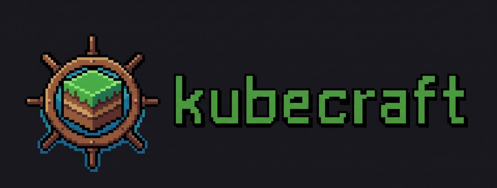

<p align="center">
  
</p>

<p align="center">
  <strong>Self-service Minecraft servers on Kubernetes.</strong><br>
  Users create and run their own servers from a web UI, inside the limits an admin sets.
</p>

<p align="center">
  kubecraft is a web app and a Helm chart. Each server is a StatefulSet in the cluster, and
  <a href="https://github.com/itzg/mc-router">mc-router</a> sends players to it by hostname
  on port 25565. Users pick a type, a version and a plan, add mods or plugins from Modrinth,
  and get live logs, a console and backups in the browser. Admins manage users, quotas and plans.
</p>

<p align="center">
  <a href="https://git.fferrando.cc/rdfilippo/kubecraft/actions?workflow=ci.yaml"></a>
  <a href="https://git.fferrando.cc/rdfilippo/kubecraft/releases"></a>
  <a href="go.mod"></a>
  
  <a href="charts/kubecraft"></a>
  <a href="LICENSE"></a>
</p>

<p align="center">
  <a href="#features">Features</a> ·
  <a href="#server-types">Server types</a> ·
  <a href="#how-it-works">How it works</a> ·
  <a href="#quick-start">Quick start</a> ·
  <a href="#configuration">Configuration</a> ·
  <a href="#documentation">Documentation</a> ·
  <a href="#contributing">Contributing</a> ·
  <a href="#license">License</a>
</p>

---

## Features

- **Self-service.** Users create, start, stop, restart and delete their own servers from a
  wizard. They only see their own servers; admins see all of them.
- **Quotas and plans.** Admins define plans (CPU, RAM, disk) and per-user limits on servers,
  RAM, CPU and storage. Checks run in a database transaction, so parallel requests cannot
  go over a quota.
- **Mods and plugins.** Paper and Purpur for plugins, Fabric, Forge and NeoForge for mods,
  with a searchable [Modrinth](https://modrinth.com) catalog. The server downloads them on start.
- **In the browser.** Live logs, an RCON console, player management (whitelist, ops), CPU and
  RAM usage, and an editor for plugin and mod config files.
- **Backups.** Download the world or the full server as a `.tar.gz`. On a running server the
  world is flushed first, so the archive is consistent.
- **Auto sleep.** Idle servers scale to zero and start again when a player joins.
- **Public servers behind CGNAT.** With [playit.gg](docs/components/playit.md), a server marked
  Public gets its own tunnel, created and removed by kubecraft.
- **Least privilege.** Only the manager talks to the Kubernetes API, with a namespaced Role.
  Game pods run non-root with no capabilities, no service account token and strict
  NetworkPolicies. Users can only change a fixed list of settings.
- **Prometheus metrics.** Per-server state, players and resources, plus API, login and
  reconciler health, with an optional ServiceMonitor.
- **One image, one chart.** A Go binary with the Svelte UI embedded, and a Helm chart
  published as an OCI artifact, ready for ArgoCD. Postgres is external.

## Server types

| Group | Types | Extras |
| --- | --- | --- |
| Vanilla | Vanilla | |
| Plugins | Paper, Purpur | Modrinth plugins, config editor |
| Mods | Fabric, Forge, NeoForge | Modrinth mods, required dependencies added on their own |

Versions are `LATEST` or any release from Mojang's version list. The type is fixed after
creation, since moving a world between loaders often breaks it. Details are in
[Mods and plugins](docs/components/mods-and-plugins.md).

## How it works

```
Browser --HTTPS--> Ingress (UI host) --> manager (Go: API + UI)
                                           |-- PostgreSQL (users, plans, quotas, servers, audit)
                                           '-- Kubernetes API (namespaced Role only)

Minecraft client --TCP 25565--> mc-router --(hostname)--> Service mc-<slug> --> StatefulSet mc-<slug>
```

- Postgres holds what users asked for (owners, plans, settings, desired state). Kubernetes
  holds what is actually running.
- A reconciler compares the two every 5 seconds: it recreates missing resources, applies
  changes, reports each server's state and cleans up deleted servers.
- Each server gets a Secret, a PVC for the world, a StatefulSet and a Service, all named
  `mc-<slug>`. Players connect to `<slug>.<serverBaseDomain>`.

The full picture is in [Architecture](docs/architecture.md), and the reasons behind each
choice are in [Design decisions](docs/decisions.md).

## Quick start

You need Kubernetes 1.28+, an ingress controller with TLS, a StorageClass, and a PostgreSQL 14+
database with a login that owns it. kubecraft never deploys a database.

Create the secrets in the target namespace:

```sh
kubectl create namespace minecraft
kubectl -n minecraft create secret generic kubecraft-db-credentials \
  --from-literal=username=kubecraft --from-literal=password='<db password>'
kubectl -n minecraft create secret generic kubecraft-secrets \
  --from-literal=SESSION_SECRET="$(openssl rand -hex 32)" \
  --from-literal=BOOTSTRAP_ADMIN_USER=admin \
  --from-literal=BOOTSTRAP_ADMIN_PASSWORD="$(openssl rand -base64 18)"
```

Write a small values file:

```yaml
manager:
  uiHost: mine.example.com
  serverBaseDomain: mine.example.com
secrets:
  existingSecret: kubecraft-secrets
database:
  host: postgres-rw.database.svc
  name: kubecraft
  credentialsSecret:
    name: kubecraft-db-credentials
ingress:
  enabled: true
```

Then install the chart:

```sh
helm install kubecraft oci://git.internal.fferrando.cc/rdfilippo/kubecraft \
  --version 0.1.0 -n minecraft -f values.yaml
```

Point the UI host at the ingress and `*.<serverBaseDomain>` at the mc-router Service
(`kubectl -n minecraft get svc kubecraft-mc-router`). Log in as the bootstrap admin, set a new
password, then create a small Paper server and connect to `<slug>.<serverBaseDomain>`.

> **Note:** Minecraft traffic is raw TCP. If the DNS is on Cloudflare, the wildcard record must
> be **DNS only** (grey cloud), and Cloudflare Tunnels cannot carry it. For servers reachable
> from the internet behind CGNAT, see [playit.gg](docs/components/playit.md).

The full walkthrough, with a CloudNativePG database, sealed secrets, Traefik and ArgoCD, is in
the [Deployment guide](docs/deployment/README.md) and its [examples](docs/deployment/examples/).

## Configuration

The chart sets the manager's environment from its values. The ones most installs change:

| Value | Default | Description |
| --- | --- | --- |
| `manager.uiHost` | `mine.example.com` | Host of the UI, also used for the origin checks |
| `manager.serverBaseDomain` | `mine.example.com` | Servers are reachable at `<slug>.<serverBaseDomain>` |
| `manager.storageClass` | cluster default | StorageClass of world volumes |
| `manager.defaultMaxServers` | `2` | Starting quota for new users, editable later in the UI |
| `database.host`, `database.credentialsSecret` | | Postgres login (or `database.urlSecret` with a full URL) |
| `secrets.existingSecret` | | Secret with `SESSION_SECRET` and the bootstrap admin |
| `ingress.enabled` / `ingressRoute.enabled` | off | Expose the UI with an Ingress or a Traefik IngressRoute |
| `mcRouter.service.type` | `LoadBalancer` | How port 25565 is exposed |
| `mcRouter.autoScale.enabled` | on | Auto sleep for servers that opt in |
| `playit.enabled` | off | Public servers through playit.gg |
| `metrics.serviceMonitor.enabled` | off | Create a ServiceMonitor for Prometheus |

Every chart value is in the [Chart reference](docs/deployment/chart-reference.md), and every
environment variable in [Configuration](docs/configuration.md).

## Documentation

| Guide | Contents |
| --- | --- |
| [Architecture](docs/architecture.md) | Parts, where state lives, a server's life, background loops |
| [Design decisions](docs/decisions.md) | Each main choice, the alternatives, and the reason |
| [Deployment](docs/deployment/README.md) | Requirements, install steps, what the chart creates |
| [Chart reference](docs/deployment/chart-reference.md) | Every value and template, sizing the ResourceQuota |
| [ArgoCD and GitOps](docs/deployment/argocd.md) | Deploying the OCI chart with ArgoCD |
| [Upgrades and releases](docs/deployment/upgrades.md) | Versions, migrations, rollbacks |
| [Configuration](docs/configuration.md) | Environment variables of the manager |
| [Components](docs/README.md#components) | API, database, reconciler, mc-router, files, quotas, mods, playit, metrics, UI |
| [Development](docs/development.md) | Local run, tests, end-to-end test, CI and releases |

## Roadmap

- [x] Plugin and modded servers with a Modrinth catalog
- [x] Auto sleep and wake on join
- [x] World and full-server backup downloads, config file editor
- [x] Public servers through playit.gg
- [ ] Scheduled backups to external storage, and restore
- [ ] Full modpacks (Modrinth `.mrpack`, CurseForge)
- [ ] OIDC login

## Contributing

Bug reports, fixes and docs are welcome. Read [CONTRIBUTING.md](CONTRIBUTING.md) before
opening a pull request.

```sh
make test-integration   # Go tests with -race against a Postgres in Docker
make test-web           # svelte-check and vitest
make lint               # golangci-lint
make e2e                # k3s in Docker, chart install, a real Paper server
```

## License

kubecraft is free software, released under the
[GNU General Public License v3.0 or later](LICENSE).
