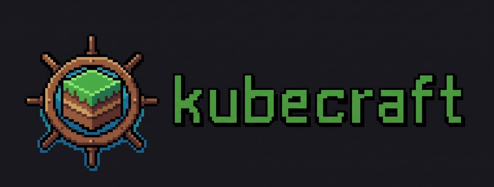

  

# kubecraft documentation

kubecraft is a web app that lets users create and run their own Minecraft servers on a
Kubernetes cluster. These pages explain every part, why it is built the way it is, and how to
deploy it. They go into more detail than the [project README](../README.md).

## Getting started

- **[Architecture](architecture.md)**: the parts, where state lives, a server's life, the
  background loops.
- **[Deployment](deployment/README.md)**: requirements, install steps, what the chart creates,
  startup order.

## Deployment

- **[Chart reference](deployment/chart-reference.md)**: every value, what each template
  creates, sizing the ResourceQuota.
- **[ArgoCD and GitOps](deployment/argocd.md)**: deploying the OCI chart with ArgoCD.
- **[Upgrades and releases](deployment/upgrades.md)**: versions, migrations, rollbacks.
- **[Examples](deployment/examples/)**: values file, ArgoCD Application, CloudNativePG
  database, secret commands.
- **[Configuration](configuration.md)**: every environment variable of the manager.

## Components

- **[Manager and API](components/manager-api.md)**: routes, auth, sessions, CSRF, roles,
  audit log.
- **[Database](components/database.md)**: Postgres schema, migrations, sqlc, connection options.
- **[Server resources](components/server-resources.md)**: what is created in Kubernetes for
  each server, and why.
- **[Reconciler](components/reconciler.md)**: how database and cluster stay in sync, states,
  deletes, orphans.
- **[mc-router and auto sleep](components/mc-router-and-auto-sleep.md)**: hostname routing,
  exposure, sleeping servers.
- **[Console, logs and live data](components/console-logs-live.md)**: WebSockets, RCON,
  player list, CPU and RAM, settings applied live.
- **[Files and backups](components/files-and-backups.md)**: file sidecar, helper pod, config
  editor, backup downloads.
- **[Quotas and plans](components/quotas-and-plans.md)**: plans, per-user limits, how checks
  avoid races.
- **[Mods and plugins](components/mods-and-plugins.md)**: Modrinth catalog, validation, how
  files reach the server.
- **[playit.gg](components/playit.md)**: public access behind CGNAT, managed tunnels, the
  gateway, routing by port.
- **[Metrics](components/metrics.md)**: the Prometheus endpoint, series, example alerts.
- **[Frontend](components/frontend.md)**: the Svelte app, its pages, how it talks to the API.

## Reference

- **[Design decisions](decisions.md)**: each main choice, the alternatives, and the reason.
- **[Development](development.md)**: local run, tests, the end-to-end test, CI and releases.

## Project

- [Contributing](../CONTRIBUTING.md)
- [Helm chart](../charts/kubecraft)
- [License (GPL-3.0-or-later)](../LICENSE)
